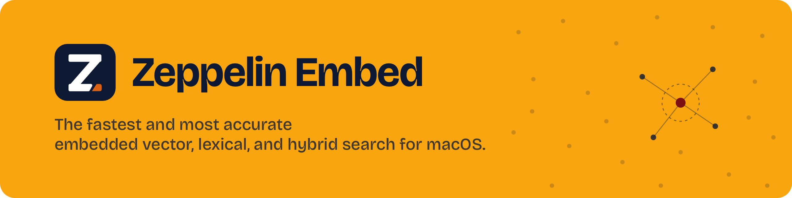
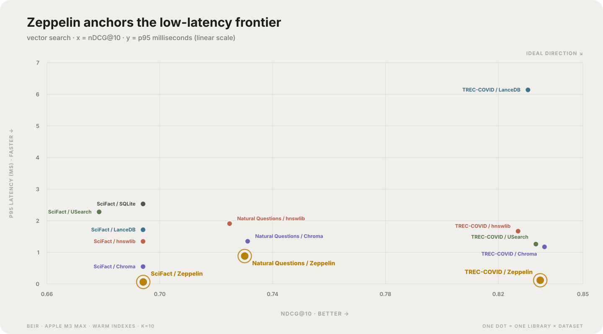

<div align="center">



[](https://github.com/zepdb/zeppelin-embed/actions/workflows/ci.yml)
[](https://github.com/zepdb/zeppelin-embed/actions/workflows/python.yml)
[](https://crates.io/crates/zeppelin-embed)
[](https://pypi.org/project/zeppelin-embed/)
[](https://www.npmjs.com/package/@zepdb/zeppelin-embed)
[](https://www.rust-lang.org)
[](LICENSE)

[Quick start](#quick-start) · [Search](#one-store-three-ways-to-search) · [APIs](#language-apis)

</div>

Zeppelin Embed is the fastest and most accurate in-process search engine built
for macOS and Apple silicon. Since v0.4.0 the same engine, C ABI, and Node
package also run natively on Windows x64.

## Search performance



Vector graph-search p95 latency is plotted against nDCG@10. Lower latency and
higher nDCG@10 are better. Measured on an Apple M3 Max using warm indexes and
k=10. The SQLite TREC-COVID result (82.36 ms p95) is omitted to keep the
remaining results legible on a linear scale.

[BEIR](https://github.com/beir-cellar/beir) is a benchmark suite for evaluating
information retrieval across different domains.

- [SciFact](https://huggingface.co/datasets/BeIR/scifact) retrieves scientific
  evidence for factual claims.
- [TREC-COVID](https://huggingface.co/datasets/BeIR/trec-covid) retrieves
  biomedical literature for COVID-19 research questions.
- [Natural Questions](https://huggingface.co/datasets/BeIR/nq) retrieves
  Wikipedia evidence for real search-engine questions.

Compared with: [Chroma](https://github.com/chroma-core/chroma), [hnswlib](https://github.com/nmslib/hnswlib), [LanceDB](https://github.com/lancedb/lancedb), [sqlite-vec](https://github.com/asg017/sqlite-vec), and [USearch](https://github.com/unum-cloud/usearch).

## Why Zeppelin Embed

- **Vector, lexical, and hybrid retrieval.** Use one store and one document ID
  space for vector similarity, BM25, or fused results.
- **Local and persistent.** The engine runs inside your process, recovers from
  its write-ahead log, and publishes immutable searchable generations.
- **Fast native execution.** Runtime-dispatched SIMD kernels, quantized graph
  traversal, exact rescoring, memory-mapped segments, and bounded worker pools.
- **Production controls.** Typed filters, idempotent document revisions,
  cancellation, deadlines, retention, physical purge, memory budgets, health,
  and query diagnostics.
- **Bring your own vectors.** Use embeddings from any model that produces
  compatible document and query vectors.
- **One native engine, several languages.** Rust, a versioned C ABI, Python,
  Swift, Node.js, and TypeScript call the same storage and retrieval
  implementation.

## One store, three ways to search

| Mode | Input | Result |
|---|---|---|
| Vector | A precomputed `float32` query vector | Approximate graph retrieval by default, with exact and scan tiers available |
| Lexical | Raw query text or a structured lexical query | BM25 ranking with term, phrase, prefix, and phonetic operators |
| Hybrid | A query vector plus text | Vector and lexical candidates fused over one pinned store generation |

Vector and hybrid graph queries use quantized traversal to select candidates and
full-precision vectors to score the retained rows. Exact search remains
available when exhaustive membership is required. Every result reports the
generation it observed, and diagnostics report the path and work that actually
ran.

## Quick start

Install the Python package and run the five-vector example:

```bash
python -m pip install zeppelin-embed
python bindings/python/examples/five_vectors_search.py
```

The example supplies its own document and query vectors. For model-backed text
ingest and queries, use the [text API](#text-api-macos-apple-silicon).

The directory is the database. Reopen the same path to recover its committed
state and continue ingesting or searching.

For Rust, add the native core to an application:

```bash
cargo add zeppelin-embed
```

## Language APIs

| API | Distribution | Example |
|---|---|---|
| Python | PyPI wheel with the native library included | [`five_vectors_search.py`](bindings/python/examples/five_vectors_search.py) |
| Rust | [`zeppelin-embed`](crates/zeppelin-embed) on crates.io | [`five_vectors_search.rs`](crates/zeppelin-embed/examples/five_vectors_search.rs) |
| Swift | Swift Package Manager with a downloadable XCFramework | [`five_vectors_search.swift`](bindings/swift/Examples/FiveVectorsSearch/Sources/FiveVectorsSearch/five_vectors_search.swift) |
| C/C++ | GitHub release archive with the header and `.a`/`.dylib` libraries | [`five_vectors_search.c`](crates/zeppelin-embed-ffi/examples/five_vectors_search.c) |
| Node.js / TypeScript | [`@zepdb/zeppelin-embed`](https://www.npmjs.com/package/@zepdb/zeppelin-embed) with the native addon included | [`javascript.cjs`](bindings/node/examples/javascript.cjs) / [`typescript.ts`](bindings/node/examples/typescript.ts) |

The C ABI uses size-versioned requests and responses, typed error codes, and
matching free functions for every callee-owned result. Python wheels include
the native library. Swift consumes the same ABI through an actor-based
interface. The Rust core and text layer are separate crates; the other packages
embed or link the C ABI.

The macOS SDK archive is language-neutral. Any runtime with C-compatible
foreign functions can use its header and static or dynamic library.

## Text API (macOS Apple Silicon)

The text API embeds documents and queries locally, stores the source text, and
retrieves it with dense (vector), lexical (BM25), or hybrid search. It is
available only on macOS Apple Silicon. Python wheels and the Node arm64 addon
require macOS 13.0 or newer; the Swift package and full C SDK require macOS 14.

The default is [aghatage/zeppelin-embed-clean71-arctic-m-v2 (model card)](https://huggingface.co/aghatage/zeppelin-embed-clean71-arctic-m-v2/blob/d64b817c4021a3f1b9bded3152d9afdf9ac813e7/README.md),
pinned to revision `d64b817c4021a3f1b9bded3152d9afdf9ac813e7`. Its clean71
query tower has 71M parameters (71,201,280, from the model pack's `PAIR.json`),
accepts 96 model tokens, and uses INT8 weight-only CoreML on the Apple Neural
Engine, with FP16 MLX query weights available when CoreML is
absent or explicitly disabled with `ZE_QUERY_COREML=off`. A discovered CoreML
model that fails to load returns an error. The document tower is
`Snowflake/snowflake-arctic-embed-m-v2.0`, FP16 on MLX, with an 8192-model-token
limit. Long-document chunking is controlled by each binding's ingest options.

The qualified model payload is **832,765,584 bytes** (about 833 MB), plus the
small manifest. The first model open downloads the pinned files from Hugging
Face, verifies their sizes and SHA-256 hashes, and atomically installs them in
the cache. Later opens verify the manifest and compare file metadata with the
verification marker, rehashing payloads when that marker no longer matches.
The cache root defaults to
`~/Library/Caches/zeppelin-embed/models`, with repository/revision directories
under it. An explicit cache directory overrides `ZE_MODEL_CACHE`, which
overrides that default. Set the binding's offline option or `ZE_MODEL_OFFLINE=1`
to forbid network access; a cache miss is an error. `ZE_MODEL_ENDPOINT` overrides
the download endpoint. A local `.zem` path can also be opened directly.

Download progress reports byte counts. Intermediate callbacks require **both
at least 64 KiB and at least 100 ms** since the last report; each verified file
also reports completion. Initial `(0, 0)` means fetching the manifest. Native
callbacks run synchronously on the resolver thread and must not reenter model
resolution; Node delivers events on the JS thread.

Measured on a **MacBook Pro, Apple M3 Max, 128 GiB, macOS 27.0** (ZE-503):
current-main FiQA FP16 graph store, with CoreML query embedding for dense and
hybrid text queries.

| Warm query | p50 ms | p95 ms |
| --- | ---: | ---: |
| Dense text | 1.102 | 1.215 |
| Lexical text | 0.964 | 3.503 |
| Hybrid text | 2.689 | 4.661 |
| Caller-supplied vector (no query embedding) | 0.071 | 0.115 |

Cold start at relaunch is **about 1.1 s** (open 860 ms + first hybrid query
263 ms). First-ever startup with the CoreML cache cleared is **about 2.1 s**.
Both measurements used a warm OS file cache (ZE-503).

MLX keeps a process-global buffer cache, capped at 4 GiB by default during text
ingest. On an Apple M3 Max with 128 GiB, a full FiQA ingest (57,638 documents)
with the release FP16 default model peaked at about 7.3 GB process footprint
(about 112 GB before the cap), with max RSS about 4.8 GB. Override the cap with
Rust's `TextOpenOptions::with_mlx_cache_limit_bytes` or
`ZE_MLX_CACHE_LIMIT_BYTES` (bytes). Bindings expose no cache-limit option: set
the environment variable before the first text open. Invalid values are errors;
the first setter in a process wins.

Verified-cache resolution is **about 0.19 ms** for a synthetic warm-cache
payload (ZE-517). This measures resolution, excluding model/runtime loading.

Sources: ZE-499 (precision and payload size), ZE-503 (query latency and cold
start), ZE-517 (cached resolution), and ZE-528 (ingest memory).

See complete default-model examples for [Rust](crates/zeppelin-embed-text/README.md),
[Python](bindings/python/README.md#text-api-macos-arm64),
[Node](bindings/node/README.md#textstore-macos-arm64), and
[Swift](bindings/swift/README.md#textstore).

### C text example

Use the full arm64 C SDK (`graph-cypher`), whose header includes the text API.
Keep `mlx.metallib` beside the dylib, or beside the final executable for static
linking; see the [C SDK installation guide](scripts/macos-sdk/README.md).
`ze_text_default_model` supplies borrowed immutable pins; do not free them.
This example creates a store, ingests, queries each leg, deletes, and closes:

```c
#include "zeppelin_embed.h"
#include <stdio.h>
#include <stdlib.h>
#include <string.h>

static void check(ze_error_code code) {
    if (code != ZE_OK) {
        fprintf(stderr, "%s\n", ze_error_code_name(code));
        exit(EXIT_FAILURE);
    }
}

int main(void) {
    const char *path = "text-store";
    ZeTextModelRef model = { .abi_size = sizeof(model) };
    check(ze_text_default_model(&model));
    ZeTextOpenModelRequest open = { .abi_size = sizeof(open) };
    open.store.abi_size = sizeof(open.store);
    open.store.path = (const uint8_t *)path;
    open.store.path_len = strlen(path);
    open.store.commit_tier = 1; /* ordered */
    open.store.reader_drain_timeout_ms = 250;
    open.store.max_resident_bytes = UINT64_MAX;
    open.store.max_temp_bytes = UINT64_MAX;
    open.repo = model.repo;
    open.repo_len = model.repo_len;
    open.revision = model.revision;
    open.revision_len = model.revision_len;
    open.manifest_sha256 = model.manifest_sha256;
    open.manifest_sha256_len = model.manifest_sha256_len;
    /* Optional: open.offline = 1; open.cache_dir/cache_dir_len override cache. */
    ze_handle store = 0;
    check(ze_text_open_model(&open, &store));

    const char *text = "The bronze zeppelin flies above the city.";
    ZeDocId id = { .high = 0, .low = 1 };
    ZeTextDocument document = {
        .abi_size = sizeof(document), .doc_id = id, .revision = 1,
        .text = (const uint8_t *)text, .text_len = strlen(text)
    };
    ZeTextIngestRequest ingest = {
        .abi_size = sizeof(ingest), .documents = &document, .document_count = 1,
        .embed_batch_size = 1, .seal_every = 1, .channel_capacity = 1
    };
    ZeMutationReport mutation = { .abi_size = sizeof(mutation) };
    check(ze_text_ingest(store, &ingest, &mutation));

    const char *query_text = "bronze zeppelin";
    for (int32_t legs = 0; legs <= 2; ++legs) { /* dense, lexical, hybrid */
        ZeTextQueryRequest query = {
            .abi_size = sizeof(query), .text = (const uint8_t *)query_text,
            .text_len = strlen(query_text), .k = 5, .legs = legs
        };
        ZeTextQueryResult result = { .abi_size = sizeof(result) };
        check(ze_text_query(store, &query, &result));
        printf("leg %d: %zu hits\n", (int)legs, result.hit_count);
        check(ze_text_query_result_free(&result));
    }
    ZeDeleteRequest deletion = {
        .abi_size = sizeof(deletion), .doc_ids = &id, .doc_id_count = 1
    };
    check(ze_text_delete(store, &deletion, &mutation));
    check(ze_close(store));
    return 0;
}
```

All request/reserved fields start at zero except the explicitly set fields.
Text caller IDs must fit in 96 bits. Successful query results own their hit
strings and must be freed once with `ze_text_query_result_free`. The V2 ingest
and query functions add cancellation, deadlines, and diagnostics; the original
functions above remain supported.

## Graph APIs in 0.6.0

`@zepdb/zeppelin-embed` ships a labelled graph MVP on darwin-arm64,
darwin-x64 and win32-x64 (Node-API 8 and Electron 44). The macOS deployment
target remains 11; `GraphStore` requires macOS 14 and refuses older systems.

```js
const { GraphStore } = require('@zepdb/zeppelin-embed');
const graph = GraphStore.open('/path/to/new-graph');
try {
  graph.apply([{ kind: 'node', operation: 'create', namespace: 'notes',
    key: 'first', revision: 1n, labels: ['Note'],
    properties: { title: 'Planning' } }]);
  console.log(graph.cypher('MATCH (n:Note) RETURN n.title').rows);
} finally {
  graph.close();
}
```

See the [Node graph API](bindings/node/README.md#graph-documents-and-cypher--060-mvp)
and [release limits](CHANGELOG.md#distribution-limits). Cypher writes are bounded
(about 121 created nodes per statement); results default to 1,024 rows with
`maxRows` up to 65,536. Graph search in Cypher and full graph qualification
are deferred. Only the Rust core publishes to crates.io. The graph C SDK and
`ZeppelinEmbedGraph` XCFramework ship as GitHub release assets for macOS 14+
arm64. The Swift graph subpackage is not yet remotely resolvable through
SwiftPM (ZE-322). Node does not yet expose structured graph query,
node/relationship getters or resource APIs.

The model-backed text C ABI ships in the macOS 14+ arm64 full artifact
(`ZeppelinEmbedGraph` / graph-cypher SDK); the universal, Intel and non-macOS
artifacts are text-free. The full XCFramework embeds MLX shaders in its dynamic
framework resources; C SDK consumers keep `mlx.metallib` beside the dylib or,
for static linking, copy it beside the executable.

## Platform support

| Package | macOS 11+, Apple silicon | Windows 10/11 x64 |
|---|---|---|
| Rust crate `zeppelin-embed` | Yes | Yes |
| Node.js `@zepdb/zeppelin-embed` | Yes | Yes, Node-API 8 or later and Electron 44 |
| C ABI | Yes, prebuilt SDK archive on the release | Yes, built from source with `cargo build -p zeppelin-embed-ffi` |
| Python wheel | Yes | No |
| Swift package | Yes | Not applicable |

Windows uses the same on-disk format and the same C ABI. Each platform verifies
the format against the same hand-written portable fixture; the macOS-to-Windows
hop itself is not yet run on an attached pair of machines, so cross-platform
exchange is designed for and checked one side at a time rather than measured
end to end. The published benchmarks were measured on Apple silicon and are not
restated for Windows. The prebuilt Node addon links the
Visual C++ runtime, so a consumer machine needs the Visual C++ redistributable.
There is no Windows SDK archive or Python wheel on the release yet.

From a source checkout, run each example with:

```bash
# Python
cargo build --release -p zeppelin-embed-ffi
PYTHONPATH=bindings/python ZEPPELIN_EMBED_LIBRARY=target/release/libzeppelin_embed_ffi.dylib \
  python bindings/python/examples/five_vectors_search.py

# Rust
cargo run --release -p zeppelin-embed --example five_vectors_search

# Node.js
cd bindings/node
npm ci
npm run build:native
node examples/javascript.cjs
cd ../..

# Swift
cargo build --release -p zeppelin-embed-ffi
ZE_USE_LOCAL_FFI=1 swift run --package-path bindings/swift/Examples/FiveVectorsSearch

# C
cargo build --release -p zeppelin-embed-ffi
cc -std=c11 crates/zeppelin-embed-ffi/examples/five_vectors_search.c \
  -I crates/zeppelin-embed-ffi/include -L target/release -lzeppelin_embed_ffi \
  -o /tmp/zeppelin-c-example
DYLD_LIBRARY_PATH=target/release /tmp/zeppelin-c-example /tmp/zeppelin-c-index
```

## Building from source

Zeppelin Embed uses stable Rust 1.93 or newer.

```bash
git clone https://github.com/zepdb/zeppelin-embed.git
cd zeppelin-embed
cargo test --workspace
```

Build the core C ABI library:

```bash
cargo build --release -p zeppelin-embed-ffi
```

Build a Python wheel:

```bash
python -m build --wheel bindings/python
```

## License

Zeppelin Embed is free software licensed under the
[GNU General Public License v3.0](LICENSE).
